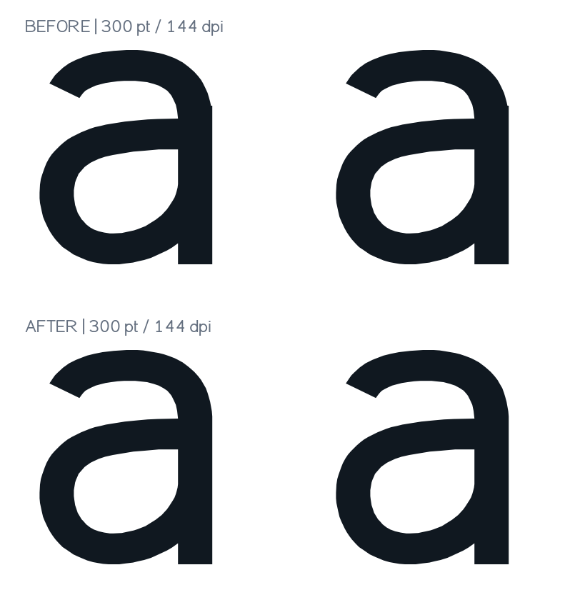
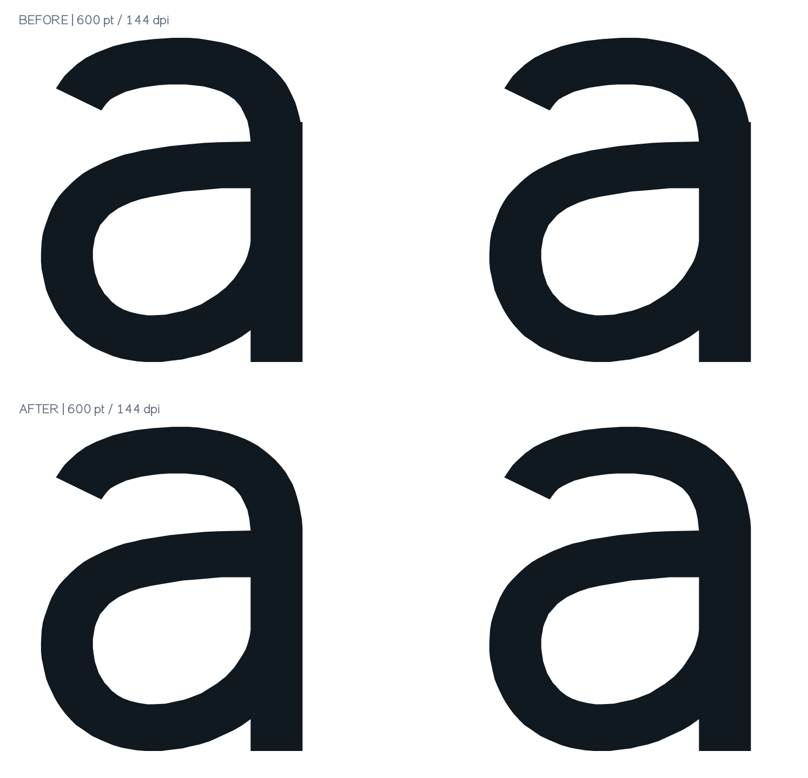
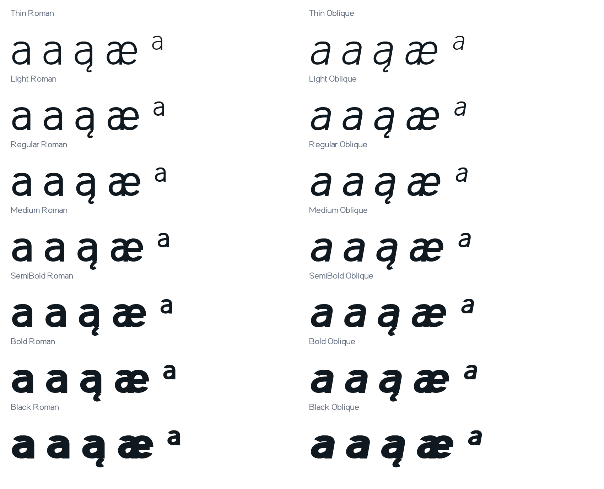
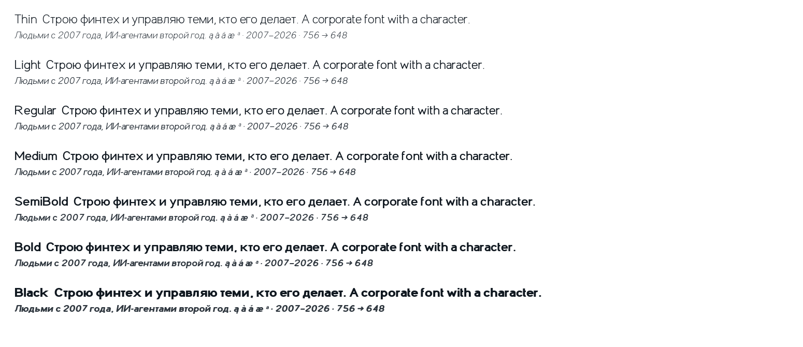

# Sans a / а junction repair

## Diagnosis before repair

The original Regular outline used the same form for U+0430 Cyrillic а and U+0061 Latin a. Points (434,370) and (437,370) formed a 3-unit horizontal shoulder at the upper arc/stem junction. At 300 pt / 144 dpi this was 1.8 pixels; it grew to 12 units in Black. The separate vertical stroke's extended flat cap caused it.

The historical a-300pt.png, a-600pt.png and outline text files preserve that diagnosis.

## Corrected source and final files

The upper arc and stem now share one source path. A short near-vertical polygon edge is fixed before rounding to keep the stem vertical after simplification. Ogonek ą uses the original base/mark union and unchanged anchors. All 14 Sans styles were rebuilt for the affected forms only; TTF instructions were regenerated with ttfautohint 1.8.4, and only their changed glyph instructions were transferred. Hinting capacity limits remain sufficient. The matching OTF, WOFF2, variable TTF/WOFF2 and web subsets carry the same repair. Mono and Code drawings were preserved.

The affected forms are a, а, æ, à, á, â, ã, ä, å, ā, ă, ą and ª. Widths, layout tables and unrelated glyphs are preserved. The bounded rebuild is in source/repair_a_junction.py and source-repair.json.

The regression test checked 56,250 glyph/weight/file cases, including variable weights from 200 through 900 in increments of 0.5. This is a recorded grid, not a claim to enumerate all real-valued weights. No shoulder was found. See regression.json and tools/test_a_junction.py.

